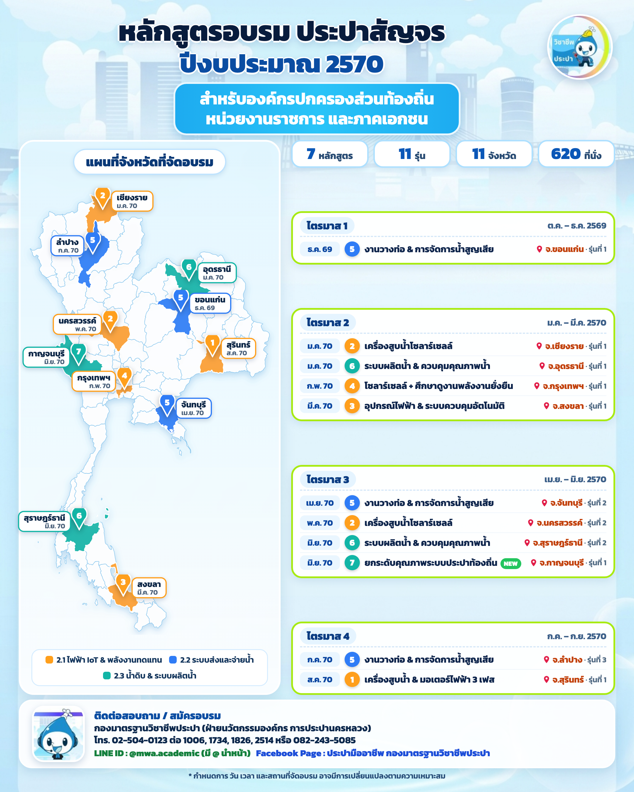
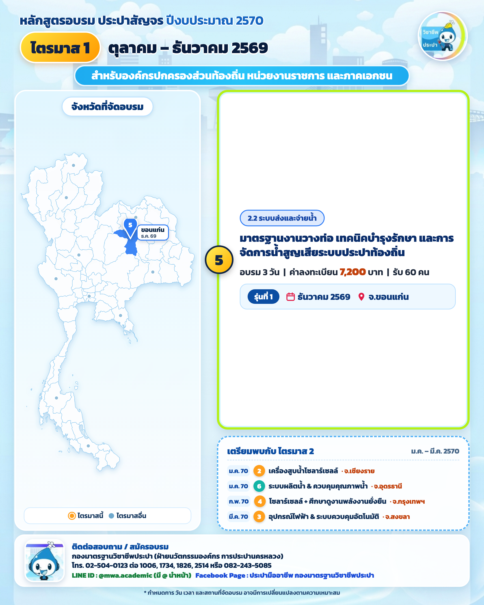
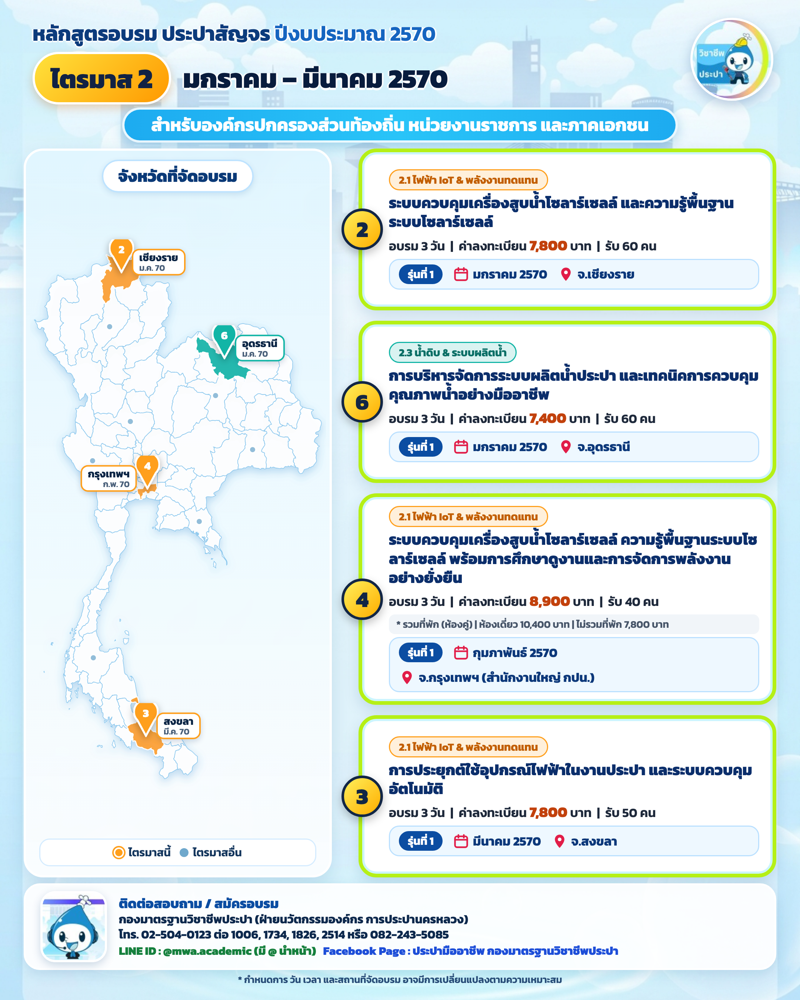
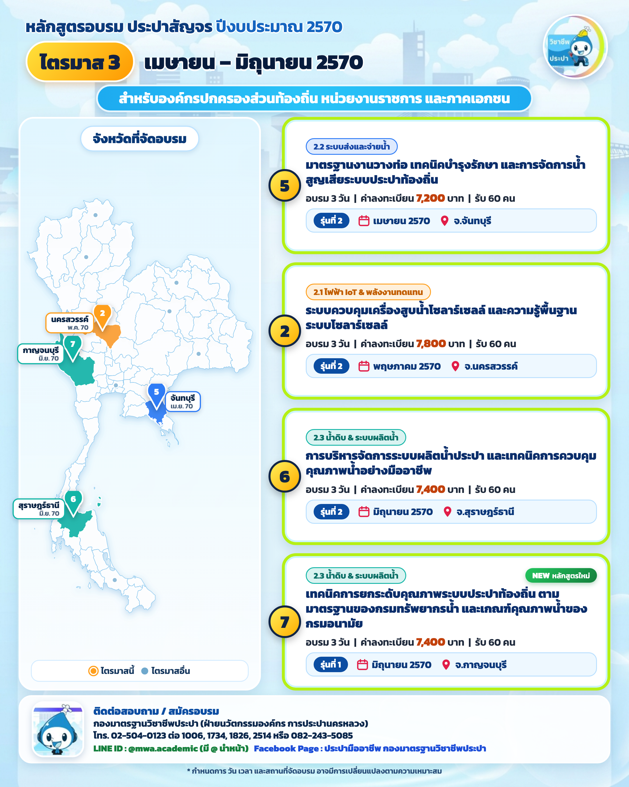
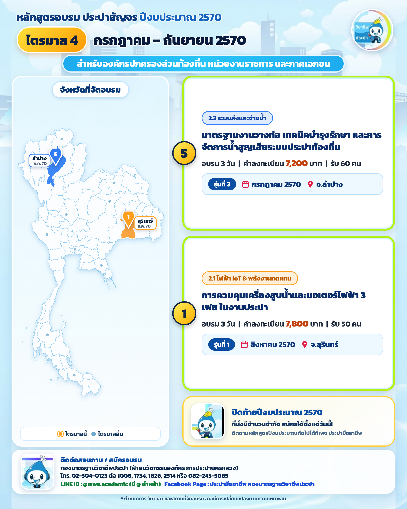

# MWA Poster Studio — ระบบแก้ไขจังหวัดและสร้างโปสเตอร์ "ประปาสัญจร" 💧

ระบบออกแบบและสร้างชุดโปสเตอร์ประชาสัมพันธ์โครงการฝึกอบรม **"ประปาสัญจร" ประจำปีงบประมาณ 2570** (กปน. การประปานครหลวง) รูปแบบ **Facebook Carousel 5 ภาพ (อัตราส่วน 4:5 ขนาด 2160×2700 px @2x)** พร้อมเครื่องมือแก้ไขจังหวัด วันเวลา และรายละเอียดหลักสูตรได้แบบสดๆ (Live Preview) และสั่งสร้างไฟล์ภาพความละเอียดสูงได้ทันที

🌐 **ใช้งานผ่านหน้าเว็บได้ทันที (GitHub Pages):**  
👉 **[เปิดใช้งาน MWA Poster Studio ออนไลน์](https://xiii13crowns-sketch.github.io/mwa-poster-studio/)** *(ไม่ต้องติดตั้งโปรแกรมใดๆ)*

---

## 🌟 จุดเด่นของระบบ

1. **เลือกเปลี่ยนจังหวัดได้ครบทั้ง 77 จังหวัดทั่วประเทศ**:
   - ระบบจะค้นหาพิกัดและระบายสีพื้นที่จังหวัดบนแผนที่ประเทศไทย ปักหมุด พร้อมเส้นชี้และป้ายชื่อให้อัตโนมัติ
   - สามารถเลือกปรับตำแหน่งป้ายชื่อบนแผนที่ (`อัตโนมัติ / ซ้าย / ขวา / บน / ล่าง`) เพื่อหลีกเลี่ยงการซ้อนทับกัน
2. **สร้างภาพความละเอียดสูง 2160×2700 px (4:5 Facebook Carousel)**:
   - เรนเดอร์ไฟล์ภาพคมชัดระดับ 2x สำหรับโพสต์โซเชียลมีเดีย
   - สั่งสร้างทีละภาพ หรือกด **"⚡ สร้างและดาวน์โหลดครบ 5 ภาพ"** หรือ **"📦 สร้างไฟล์ .ZIP"** ได้ในคลิกเดียว
3. **Single-File Portable 100%**:
   - หน้าเว็บฝังฟอนต์ `Kanit`, เวกเตอร์แผนที่ 77 จังหวัด, รูปภาพโลโก้/มาสคอต และระบบเรนเดอร์ Canvas ไว้ในไฟล์เดียว
   - สามารถดาวน์โหลดไฟล์ `MWA_Poster_Portable.html` หรือ `index.html` ไปเปิดใช้งานแบบ Offline บนเครื่อง PC อื่น (Windows / Mac) ได้ทันทีโดยไม่ต้องต่ออินเทอร์เน็ต
4. **บันทึกและแชร์ข้อมูลได้สะดวก**:
   - บันทึกการแก้ไขลงเบราว์เซอร์อัตโนมัติ
   - มีปุ่ม **"💾 บันทึกข้อมูล (.json)"** และ **"📂 โหลดข้อมูล (.json)"** สำหรับส่งต่อแผนการจัดอบรมให้ผู้อื่นแก้ไขต่อได้ทันที

---

## 🖼️ ภาพตัวอย่างชุดโปสเตอร์ (5 ภาพ)

| ลำดับภาพ | รายละเอียด | ภาพตัวอย่าง |
| :---: | :--- | :---: |
| **00** | **ภาพรวมทั้งปี (Overview)**<br>• แผนที่ 11 จังหวัดเป้าหมาย<br>• สรุป 7 หลักสูตร 11 รุ่น 11 จังหวัด<br>• แถบ Timeline ไตรมาส Q1–Q4 |  |
| **01** | **ไตรมาส 1 (ต.ค. – ธ.ค. 2569)**<br>• รุ่นที่ 1: หลักสูตร #5 จ.ขอนแก่น (ธ.ค. 69)<br>• การ์ดพรีวิวเตรียมพบกับไตรมาส 2 |  |
| **02** | **ไตรมาส 2 (ม.ค. – มี.ค. 2570)**<br>• เชียงราย, อุดรธานี, กรุงเทพฯ, สงขลา |  |
| **03** | **ไตรมาส 3 (เม.ย. – มิ.ย. 2570)**<br>• จันทบุรี, นครสวรรค์, สุราษฎร์ธานี, กาญจนบุรี |  |
| **04** | **ไตรมาส 4 (ก.ค. – ก.ย. 2570)**<br>• ลำปาง, สุรินทร์<br>• การ์ด CTA ปิดท้ายปีงบประมาณ 2570 |  |

---

## 🚀 วิธีการใช้งาน

### 1. ใช้งานออนไลน์ผ่าน GitHub Pages (แนะนำ)
เปิดลิงก์ 👉 **[https://xiii13crowns-sketch.github.io/mwa-poster-studio/](https://xiii13crowns-sketch.github.io/mwa-poster-studio/)**  
เลือกเปลี่ยนจังหวัดที่จัดอบรมทางแถบด้านซ้าย ตัวอย่างโปสเตอร์จะเปลี่ยนตามทันที จากนั้นกดปุ่มดาวน์โหลดรูป PNG หรือ ZIP ด้านบน

### 2. ใช้งานแบบ Portable บนเครื่อง PC อื่น (Offline)
- ก๊อปปี้ไฟล์ `MWA_Poster_Portable.html` หรือดาวน์โหลด `MWA_Poster_Portable_สำหรับก๊อปวางเครื่องอื่น.zip`
- ดับเบิลคลิกเปิดไฟล์ด้วย **Google Chrome** หรือ **Microsoft Edge** ใช้งานได้ทันทีโดยไม่ต้องติดตั้งโปรแกรมใดๆ

### 3. รันเซิร์ฟเวอร์ภายในเครื่อง (Local Server)
```bash
git clone https://github.com/xiii13crowns-sketch/mwa-poster-studio.git
cd mwa-poster-studio

# เปิดระบบเว็บสตูดิโอ
python3 app.py --open
```

### 4. สั่งงานผ่าน Command Line (CLI)
```bash
# ดูรายการรุ่นอบรมและจังหวัดทั้งหมด
python3 manage.py list

# เปลี่ยนจังหวัดตามลำดับ ID แล้วสั่งสร้างรูปใหม่ทันที
python3 manage.py set --id 1 --province อุบลราชธานี --build

# สั่งสร้างรูป PNG ทั้ง 5 ภาพใหม่ทั้งหมด
python3 manage.py build
```

---

## 📁 โครงสร้างโปรเจกต์

```text
├── index.html                   # หน้าเว็บ Portable Web App หลัก (สำหรับ GitHub Pages)
├── MWA_Poster_Portable.html     # ไฟล์ Standalone แบบพกพา (รวมทุกอย่างไว้ในไฟล์เดียว)
├── app.py                       # Local Web Server และ REST API
├── studio.html                  # หน้า Web Studio เมื่อรันผ่าน app.py
├── build.py                     # เอนจินคำนวณพิกัดแผนที่ GeoJSON และเรนเดอร์โปสเตอร์
├── manage.py                    # เครื่องมือ CLI สำหรับดู/แก้ไขข้อมูลจาก Terminal
├── make_portable.py             # สคริปต์คอมไพล์ระบบเป็น Single-file Portable
├── provinces.py                 # พจนานุกรมชื่อจังหวัด 77 จังหวัด (ไทย -> GeoJSON)
├── poster.css                   # สไตล์ชีตการจัดวางโปสเตอร์และ Typography (Kanit)
├── data.json                    # ข้อมูลหลักสูตร รุ่น จังหวัด และค่าลงทะเบียน
├── data.default.json            # ข้อมูลต้นฉบับเริ่มต้นของปีงบประมาณ 2570
├── assets/                      # ฟอนต์ Kanit, ภาพพื้นหลัง, ตราสัญลักษณ์ กปน., มาสคอต
└── output/                      # ไฟล์ภาพผลลัพธ์ PNG ขนาด 2160×2700 px (5 ภาพ)
```

---
*จัดทำขึ้นสำหรับโครงการฝึกอบรม ประปาสัญจร กองมาตรฐานวิชาชีพประปา ฝ่ายนวัตกรรมองค์กร การประปานครหลวง*
